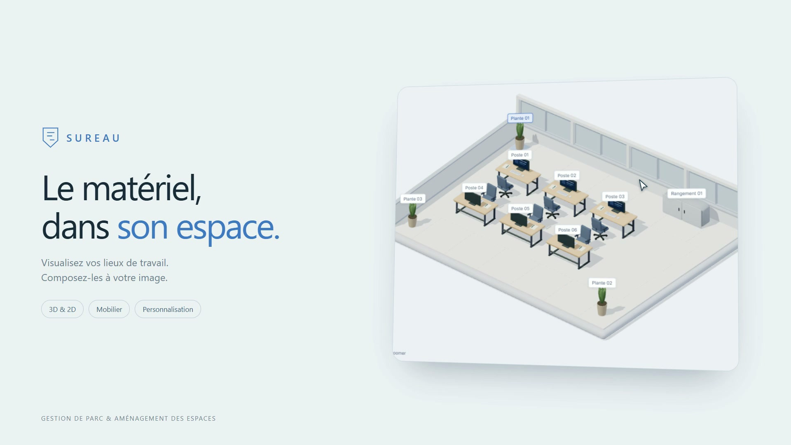
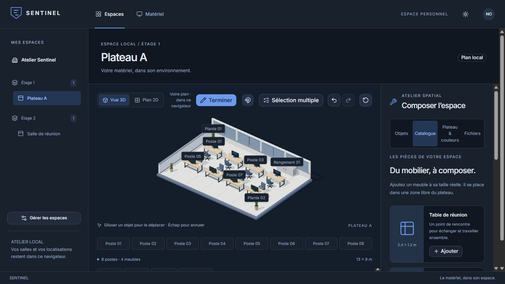
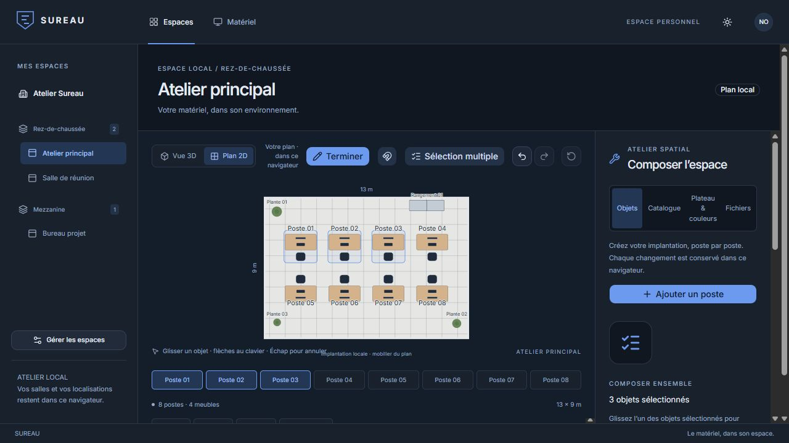
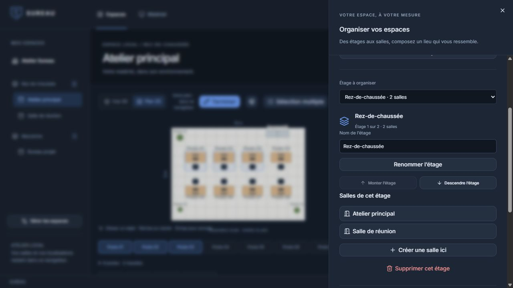

<p align="center">
  
</p>

<h1 align="center">Sureau</h1>

<p align="center">
  <strong>Le matériel, dans son espace.</strong><br />
  Un parc informatique à explorer. Des espaces de travail à composer.
</p>

<p align="center">
  <a href="#présentation-vidéo">Vidéo</a> ·
  <a href="#aperçu">Aperçu</a> ·
  <a href="#fonctionnalités">Fonctionnalités</a> ·
  <a href="#installer-sureau">Installer</a> ·
  <a href="#comptes-et-droits">Comptes</a> ·
  <a href="#données-et-sauvegardes">Données</a> ·
  <a href="#architecture">Architecture</a> ·
  <a href="frontend/README.md">Guide frontend</a>
</p>

Sureau associe un inventaire de matériel à un atelier spatial en **2D et 3D**. L’objectif : retrouver les équipements dans leur environnement et donner à chaque équipe les outils pour dessiner ses salles, organiser ses postes et personnaliser son plateau.

Sureau s’installe **sur votre propre infrastructure** : une instance regroupe l’application (API **Java / Spring Boot** et interface **React / TypeScript**), sa base **PostgreSQL**, ses comptes et ses plans partagés. Toutes les fonctions, dont la personnalisation 3D, sont présentes dans l’installation autonome.

## Présentation vidéo

[](https://github.com/Nadjide/sureau/blob/main/frontend/docs/videos/sureau-presentation.mp4 "Ouvrir la présentation de Sureau sur GitHub")

**[▶ Ouvrir la vidéo](https://github.com/Nadjide/sureau/blob/main/frontend/docs/videos/sureau-presentation.mp4)** · 2 min 01 s · Full HD (1080p) · 30 images/s · MP4, 12,7 Mo

Deux minutes sur une instance réelle, installée pour l’occasion : installation en deux commandes, premier compte administrateur, inventaire partagé, exploration et personnalisation en 3D, étages et salles, enregistrement en équipe, sauvegarde et mise à jour. Les données (« Studio Lumen ») sont fictives. La vidéo se refait automatiquement avec [`docs/presentation`](docs/presentation/README.md).

## Aperçu



*Un atelier manipulable : sélectionner un poste rapproche la caméra ; le mode édition permet de déplacer les objets et d’ajouter du mobilier à sa taille réelle.*

<details>
  <summary><strong>Voir le plan 2D et la sélection multiple</strong></summary>



Le plan 2D et les listes d’objets offrent aussi une navigation au clavier. Une sélection peut être déplacée, pivotée, dupliquée ou transférée vers une autre salle.

</details>

<details>
  <summary><strong>Voir l’organisation des salles et des étages</strong></summary>



Les salles peuvent être créées, copiées, renommées et déplacées entre les étages. L’organisation complète est exportable dans un fichier JSON.

</details>

*Captures réalisées dans l’application avec une implantation locale illustrative.*

## Fonctionnalités

| Parcourir | Composer |
| --- | --- |
| Inventaire partagé : création, modification et retrait du matériel, recherche et filtres par état | Ajout, déplacement, rotation, copie et suppression des postes |
| Fiches du matériel et localisations explicites sur les postes | Tables, rangements, plantes, cloisons et canapés |
| Vue 3D avec rapprochement animé et recentrage | Sélection multiple et actions sur un groupe d’objets |
| Plan 2D et listes accessibles au clavier | Dimensions, couleurs et ambiances personnalisables |
| Navigation entre les salles et les étages | Transfert d’objets entre salles et organisation des étages |
| États de chargement et erreurs de connexion visibles | Annuler / rétablir, import / export des plans et des espaces |

| Partager | Administrer |
| --- | --- |
| Un espace partagé par toute l’équipe, enregistré explicitement sur le serveur | Comptes administrateur, éditeur et lecteur |
| Détection des modifications concurrentes, sans perte du brouillon | Création, désactivation et changement de rôle des comptes |
| Récupération volontaire des anciens plans du navigateur | Mots de passe : changement personnel et réinitialisation par un administrateur |

Les vues 2D et 3D partagent le même plan. L’aimantation à une grille de 25 cm facilite les déplacements ; les limites du plateau prennent en compte les fauteuils et les dimensions du mobilier. Les animations respectent la préférence système de réduction des mouvements.

## Installer Sureau

Seul **Docker** (avec Compose v2) est nécessaire : ni Java ni Node ne sont à installer sur la machine. Depuis la racine du dépôt :

```sh
git clone https://github.com/Nadjide/sureau.git
cd sureau
deploy/sureau.sh init     # crée la configuration et ses secrets aléatoires
deploy/sureau.sh up       # construit l'image puis démarre l'application et sa base
```

Sous Windows, remplacer `deploy/sureau.sh` par `deploy\sureau.cmd`. La première construction prend plusieurs minutes.

Ouvrez ensuite **http://127.0.0.1:8080** et créez le premier administrateur avec la clé d’installation affichée par `init`. Elle figure aussi dans `.env.instance`, un fichier ignoré par Git qui contient les secrets de l’instance : sauvegardez-le avec vos données.

Les guides détaillés :

- [Installation](docs/installation.md) : prérequis, premier administrateur, HTTPS, plusieurs instances, configuration.
- [Exploitation](docs/exploitation.md) : sauvegarde, restauration, déplacement d’une instance, mise à jour, désinstallation.
- [Kubernetes](deploy/kubernetes/README.md) : déploiement d’une instance dédiée avec Kustomize.

Sureau se sert à la **racine d’un domaine ou d’un sous-domaine** (par exemple `sureau.exemple.org`), pas sous un sous-chemin comme `/sureau/`. Pour une exposition sur Internet, placez-le derrière HTTPS et activez le cookie sécurisé (voir le guide d’installation).

### Hébergement, licence et état du projet

- **Auto-hébergement.** L’installation autonome est le produit complet. Une instance, c’est une organisation : ses comptes, son parc et ses plans ne sont jamais mélangés avec ceux d’une autre.
- **Hébergement géré.** Une offre où l’instance serait exploitée pour vous est envisagée, avec la même application dans une instance dédiée. **Elle n’existe pas aujourd’hui** : aucun service, tarif, délai d’intervention ou garantie de disponibilité n’est proposé.
- **Licence.** Aucune licence n’a encore été choisie pour ce dépôt. Tant qu’elle n’est pas publiée, ne le présentez pas comme un projet open source.
- **Images.** Le dépôt contient un workflow de publication d’images sur GitHub Container Registry, déclenché par un tag de version. En l’absence de version publiée, l’installation construit l’image localement.
- **Limites.** Une instance tourne sur une seule machine ou une seule réplique, sans haute disponibilité. Les paliers de charge et la montée en échelle n’ont pas été mesurés.

## Comptes et droits

Au premier démarrage, l’interface demande la clé d’installation pour créer le compte administrateur. Les comptes appartiennent à l’instance : ils ne dépendent d’aucun service externe.

| Rôle | Peut |
| --- | --- |
| **Administrateur** | Tout ce que fait un éditeur, et gérer l’équipe : créer des comptes, changer leur rôle, les désactiver, réinitialiser leur mot de passe |
| **Éditeur** | Créer, modifier et retirer du matériel ; modifier et enregistrer l’espace partagé |
| **Lecteur** | Consulter l’inventaire et l’espace, et exporter un brouillon |

Chacun change son propre mot de passe depuis le menu du compte (12 à 64 caractères). Le menu **Gérer l’équipe** est réservé aux administrateurs. Désactiver un compte, changer un mot de passe ou un rôle ferme les sessions concernées. Le dernier administrateur actif ne peut pas être retiré : conservez toutefois au moins deux administrateurs. Une session expire après 8 heures d’inactivité ; une expiration ne fait pas perdre le brouillon en cours.

Contre la recherche de mots de passe, un compte est bloqué 30 secondes après 5 échecs de connexion, puis deux fois plus longtemps à chaque nouvel échec, jusqu’à 15 minutes. Une connexion réussie remet son compteur à zéro. Une même adresse est aussi bloquée après 30 échecs, tous comptes confondus, y compris les essais de clé d’installation. L’écran de connexion indique le délai à attendre. Ces compteurs sont gardés en mémoire : un redémarrage de l’application les efface.

## Données et sauvegardes

| Donnée | Où elle est conservée |
| --- | --- |
| Matériels et statuts métier | API REST et base PostgreSQL de l’instance |
| Comptes, rôles et sessions | Base PostgreSQL de l’instance |
| Étages, salles, postes, mobilier et ambiances | Espace partagé, enregistré dans la base |
| Association entre un matériel et un poste | Espace partagé, par identifiant stable du matériel |
| Thème d’affichage | Navigateur de chaque personne |
| Historique d’édition | 50 dernières modifications pendant la session |

Placer un équipement sur un poste ne change pas son statut métier. Les objets dessinés dans la scène sont du mobilier illustratif ; un équipement n’y est localisé qu’après une association explicite. Un lien vers un matériel introuvable est conservé et signalé.

**Enregistrement explicite.** Les modifications de l’atelier restent dans un brouillon tant que « Enregistrer l’espace » n’a pas été utilisé. Un enregistrement envoie ensemble les salles et les localisations, de façon atomique, avec le numéro de version connu. Si quelqu’un a enregistré entre-temps, l’interface indique qu’une autre version est disponible et bloque l’envoi sans toucher au brouillon : on peut l’exporter, puis choisir de le remplacer par la version du serveur. Rien n’est synchronisé en temps réel et l’interface ne prétend jamais qu’un changement est partagé avant la confirmation du serveur. Le matériel suit la même logique : une fiche modifiée entre-temps par quelqu’un d’autre est refusée plutôt qu’écrasée.

**Anciens plans du navigateur.** Les plans créés avant l’espace partagé restent dans le navigateur qui les contient. Le panneau « Retrouver vos anciens plans » les recherche à la demande, affiche un aperçu et les copie dans le brouillon ; les données d’origine ne sont ni modifiées ni supprimées.

**Export JSON de l’espace.** Il contient l’organisation, les plans et les localisations de matériel, repérées par identifiant : ces dernières n’ont de sens que sur la même instance, et l’import propose de les conserver ou de les remplacer explicitement. Il sert à garder une copie ou à transférer une implantation, mais il **ne remplace pas une sauvegarde de l’instance** : l’inventaire et les comptes n’y figurent pas.

**Sauvegarde complète.** `deploy/sureau.sh backup` produit une archive PostgreSQL contenant les comptes, l’inventaire, les plans, leurs associations et l’historique des migrations, sans le contenu des sessions. Une restauration ferme toutes les sessions. La procédure complète, y compris la restauration vers une autre instance, est décrite dans le [guide d’exploitation](docs/exploitation.md).

Un espace peut contenir jusqu’à **8 étages et 32 salles**, avec **64 postes et 64 meubles par salle**.

## Développement

**Prérequis :** Node.js **22.12 ou supérieur**, pnpm **12.14.0**, Java **21** et Docker.

```sh
# Base de développement (volume distinct de celui d'une instance installée)
docker compose up -d

# API : la clé d'installation permet de créer le premier administrateur
cd backend
SUREAU_SETUP_TOKEN=une-cle-locale ./mvnw spring-boot:run
# PowerShell : $env:SUREAU_SETUP_TOKEN = 'une-cle-locale'; ./mvnw.cmd spring-boot:run

# Interface, dans un autre terminal
cd frontend
pnpm install --frozen-lockfile
pnpm dev
```

Ouvrir l’adresse affichée par Vite, généralement **http://127.0.0.1:5173** ; le proxy de développement relaie `/api` vers **http://127.0.0.1:8080**. Pour une autre adresse, copier `frontend/.env.example` dans `frontend/.env.local` et adapter `SUREAU_API_TARGET`.

Le [fichier Compose de développement](docker-compose.yml) configure une base locale avec les valeurs par défaut `sureau` et le volume physique `sureau_postgres_data`. Pour réutiliser une base existante, renseigner son volume dans `SUREAU_POSTGRES_VOLUME` et conserver ses valeurs dans `DB_NAME`, `DB_USERNAME` et `DB_PASSWORD`, puis fournir aussi `DB_URL` au processus Java si le nom de base diffère. Les variables `POSTGRES_*` n’initialisent qu’un volume neuf. Ce fichier ne sert pas aux installations : celles-ci utilisent [`docker-compose.install.yml`](docker-compose.install.yml), avec un volume propre à chaque instance.

Les migrations de schéma sont gérées par Flyway à partir de [`db/migration`](backend/src/main/resources/db/migration). Une API indisponible produit un message explicite : l’interface ne remplace jamais l’inventaire par des matériels fictifs.

## Vérifications

| Partie | Commande |
| --- | --- |
| Frontend (dans `frontend/`) | `pnpm typecheck`, `pnpm lint`, `pnpm test`, `pnpm build` |
| Backend (dans `backend/`) | `./mvnw test`, avec une base de test (voir ci-dessous) |
| Parcours de bout en bout | `sh e2e/run.sh` |

Les tests du backend visent par défaut `127.0.0.1:15432/sureau_test` (variables `TEST_DB_URL`, `TEST_DB_USERNAME`, `TEST_DB_PASSWORD`), jamais la base de développement. Une base dédiée se lance ainsi :

```sh
docker run -d --name sureau-test-db -e POSTGRES_DB=sureau_test -e POSTGRES_USER=sureau_test \
  -e POSTGRES_PASSWORD=sureau_test_only -p 127.0.0.1:15432:5432 postgres:17-alpine
```

`e2e/run.sh` installe une instance jetable avec les scripts de déploiement, puis vérifie avec un vrai navigateur l’installation du premier administrateur, l’inventaire, les droits, l’enregistrement explicite du plan, sa personnalisation (poste, mobilier, couleurs, étage, salle, localisation d’un matériel), l’accessibilité des écrans principaux dans les deux thèmes (règles WCAG A et AA vérifiées par axe-core), la 3D, le redémarrage, la sauvegarde et la restauration. Il demande Docker, pnpm et un navigateur Playwright (`cd e2e && pnpm install --frozen-lockfile && pnpm exec playwright install chromium`).

L’intégration continue (GitHub Actions) exécute ces vérifications sur chaque pull request. Le workflow de publication d’images rejoue la même validation avant de construire. Dependabot ([`.github/dependabot.yml`](.github/dependabot.yml)) propose chaque lundi les mises à jour des dépendances JavaScript, Java, des actions et des images de base, avec 14 jours de recul sur chaque version ; elles passent par la même CI.

## Stack

| Partie | Technologies |
| --- | --- |
| Interface | React 19 · TypeScript strict · Vite 8 |
| Composants et styles | shadcn/ui · Radix UI · Tailwind CSS 4 · Lucide |
| Scène 3D | Three.js · React Three Fiber · Drei |
| Validation et qualité | Zod · Vitest · Oxlint |
| API | Java 21 · Spring Boot 4 · Spring Web MVC · Spring Security |
| Persistance serveur | PostgreSQL · Spring Data JPA · Flyway · sessions JDBC |
| Livraison | Docker · Docker Compose · Kubernetes (Kustomize) |
| Tests et CI | Playwright · GitHub Actions |
| Outils | pnpm · Maven |

Les versions résolues du frontend sont conservées dans le [lockfile pnpm](frontend/pnpm-lock.yaml). L’inventaire, l’éditeur, la gestion des espaces et la scène 3D sont chargés à leur ouverture.

## Architecture

```text
sureau/
├── frontend/
│   ├── docs/                  # Captures et vidéo de présentation
│   ├── public/                # Identité visuelle
│   └── src/
│       ├── components/        # Navigation et composants d’interface
│       └── features/
│           ├── auth/          # Connexion, session et mot de passe
│           ├── users/         # Gestion de l’équipe
│           ├── inventory/     # API, validation et fiches matériel
│           └── spatial/       # Plans, édition, scène 3D et espaces partagés
├── backend/
│   └── src/main/
│       ├── java/              # auth, asset, workspace, common
│       └── resources/         # Configuration et migrations Flyway
├── deploy/                    # Scripts d’installation, Kubernetes
├── docs/                      # Guides d’installation et d’exploitation, tournage de la vidéo
├── e2e/                       # Parcours de bout en bout (Playwright)
├── Dockerfile                 # Image unique : interface + API
├── docker-compose.install.yml # Installation d’une instance
└── docker-compose.yml         # Base de développement
```

L’interface compilée est servie par l’API : une instance n’expose qu’une origine HTTP, sans configuration CORS ni domaine externe.

### Contrat de l’API

Toutes les routes `/api` demandent une session, sauf `status`, `csrf`, `setup` et `login`. Les écritures exigent le jeton CSRF fourni par `GET /api/auth/csrf`. Seuls les points de santé `/actuator/health` sont publics, sans détail.

| Méthode | Route | Rôle requis | Opération |
| --- | --- | --- | --- |
| `GET` | `/api/auth/status` | public | Savoir si l’installation initiale est à faire |
| `GET` | `/api/auth/csrf` | public | Obtenir le jeton CSRF |
| `POST` | `/api/auth/setup` | clé d’installation | Créer le premier administrateur |
| `POST` | `/api/auth/login` · `/api/auth/logout` | public · session | Ouvrir et fermer la session |
| `GET` | `/api/auth/me` | session | Consulter son compte |
| `POST` | `/api/auth/password` | session | Changer son mot de passe |
| `GET` · `POST` · `PUT` | `/api/users` · `/api/users/{id}` | administrateur | Lister, créer, modifier un compte |
| `POST` | `/api/users/{id}/password` | administrateur | Réinitialiser un mot de passe |
| `GET` | `/api/assets` · `/api/assets/{id}` | session | Lister et consulter les matériels |
| `POST` · `PUT` | `/api/assets` · `/api/assets/{id}` | éditeur | Créer et modifier un matériel |
| `PATCH` | `/api/assets/{id}/retire` | éditeur | Retirer un matériel du parc |
| `GET` · `PUT` | `/api/workspace` | session · éditeur | Lire et enregistrer l’espace et ses localisations |

La modification d’un matériel et l’enregistrement de l’espace portent le numéro de version connu : une version périmée est refusée. `GET /api/workspace` répond 404 tant qu’aucun espace n’a été enregistré.

Pour les réglages et le comportement détaillé de l’atelier, consulter le [guide frontend](frontend/README.md).

---

Développé par [Nadjide Omar](https://github.com/Nadjide).
